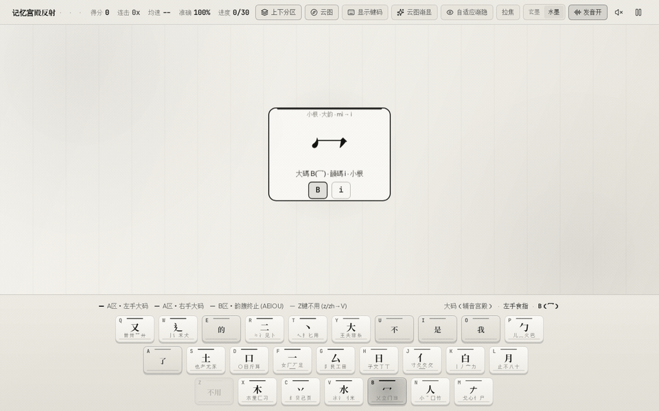
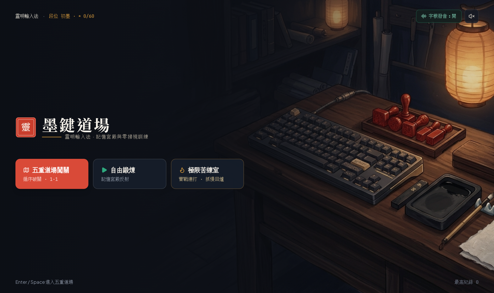
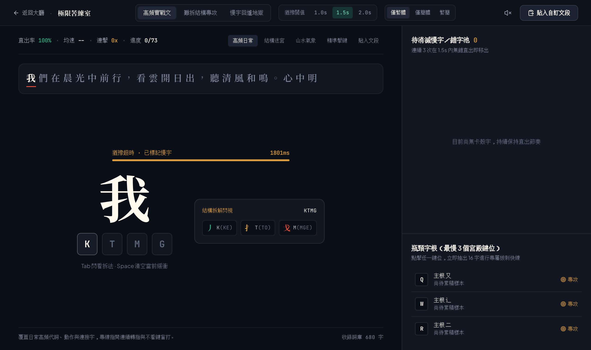

<div align="center">

# 墨键道场（InkKey Dojo）

**专为形码输入法（灵明输入法）打造的节奏型肌肉记忆道场与极限苦练系统**

<br />

<a href="https://lvxiaoc.github.io/lingming_input_training/">
  
</a>

### 👉 [即刻开始锻炼 · 启动墨键道场](https://lvxiaoc.github.io/lingming_input_training/) 👈

[](https://lvxiaoc.github.io/lingming_input_training/)

*点击上方 **即刻开始锻炼** 或动画即可免安装直接打开在线练习：`https://lvxiaoc.github.io/lingming_input_training/`*

<br />

<a href="https://lvxiaoc.github.io/lingming_input_training/">
  
</a>

</div>

---

## 核心理念：为形码而生的肌肉记忆训练

学习形码（Shape-based Input Methods）最大的瓶颈，往往不在「看不懂规则」，而在**大脑与手指之间存在多层转译延迟**（「看字 → 想口诀 → 找字根 → 低头找键位」）。**墨键道场**针对形码学习的四个核心痛点设计：

1. **三景深零扫视锻炼**：以「远景虚化 Alice 分离式键盘 ＋ 中景巨字笔画云图 ＋ 前景打字焦点」引导视线锁定字形本身，戒除低头找键盘的习惯。
2. **渐隐鹰架（Adaptive Scaffolding）**：依单字与按键熟练度自动淡化键位与提示，平滑过渡至纯盲打状态。
3. **繁简双轨分流**：支持「仅繁体」、「仅简体」与「繁简全集」切换；选择单一字集时会同步切换界面繁简，并在记忆宫殿中自动淡化非目标字集的字根，避免同根异键记忆冲突。
4. **实战延迟驱动强化（EMA 弱键 ＋ 慢字回炉）**：精准记录每次击键的反应时间与错误率，并将犹豫超时或打错的字强制收入「慢字／错字池」，直到连续无误快速直出才移出。

---

## 五重道场渐进闯关系统

五重道场共分 **5 大章节、20 个训练关卡（含每章终极检定战）**，每一关针对一个具体的形码认知难关设计；累积星数可晋升道场段位（`初墨` → `立柱` → `解构` → `入殿` → `点睛` → `墨键宗师`）：

| 章节 | 场景 | 攻克难关 | 关卡结构与训练目标 |
| :--- | :--- | :--- | :--- |
| **第一关 · 立柱・二十主根** | 初墨定盘 | **键位空间锚点**<br>克服 25 键无意识寻找 | • `1-1` 中排基准（8 主根：土口一厶日亻白月）<br>• `1-2` 上排领衔（6 主根：又辶二丶大勹）<br>• `1-3` 下排沉底（6 主根：木丷水冖人𠂇）<br>• `检定战` 二十宫立柱试（24 题全盘巡回，限 3 枚墨心印容错） |
| **第二关 · 拆骨・主根组字** | 折竹解构 | **汉字结构切分**<br>从看整图转为按笔顺拆骨 | 100% 仅用第一关 20 个主根拼写真实汉字，零新字根负担：<br>• `2-1` 双根成字（明、林、休、友、有、泉 等）<br>• `2-2` 三根与叠字（森、晶、品、速、坐、倡 等）<br>• `2-3` 繁构与大根免三（体会「一二三末、大根免三」）<br>• `检定战` 初字连斩试（25 字混编连打） |
| **第三关 · 筑宫・全根入殿** | 记忆宫殿 | **宫殿扩张自动化**<br>消除从主根转译的二段思考 | 先逐键巡礼 20 座单键记忆宫殿，再由高频至外围分层混测：<br>• `3-1` 高频殿堂（第 2–5 顺位核心延伸字根）<br>• `3-2` 中频回廊（第 6–9 顺位偏旁与字根）<br>• `3-3` 全殿巡礼（第 10 顺位以下外围与变体）<br>• `检定战` 百根巡殿试（30 题全宫殿弱键加权混测） |
| **第四关 · 点睛・字中辨根** | 墨脉透视 | **语境视觉剥离**<br>克服字根被压扁／包围后的失认 | 整字淡墨呈现，精准点亮目标部件真实笔画：<br>• `4-1` 偏旁显形（左右／上下结构高亮偏旁全码）<br>• `4-2` 藏锋剥离（艹、囗、辶、疒、穴、攵 等包围与穿插变形）<br>• `4-3` 笔顺连点（进阶：依笔顺接力输入整字内所有字根全码）<br>• `检定战` 透视辨根试（28 题混合挑战） |
| **第五关 · 化境・整字实战** | 行云流水 | **动作组块化**<br>整字多键连击无需逐根停顿 | 融会拆字、全宫殿与辨根，进入盲打组块流：<br>• `5-1` 百字初试（全字根覆盖常用单字静心实战）<br>• `5-2` 词韵连打（常用双字词组连贯推进）<br>• `5-3` 疾风落字（60fps 动态节奏抗压演练）<br>• `检定战` 墨键宗师试（36 字纯盲打终极检定，通过即证宗师） |

---

## 其他核心训练入口

### 1. 记忆宫殿 · 笔画键位云图
- 以可视化云图展开所有辅音键位的字根群组与记忆助记词。
- 可直接点击任一宫殿键位进入单键专属巡礼，并依当前繁简字集设定自动区分常用字根。

### 2. 自由锻炼（Free Play）
提供三种随时切换的练功模式，并支持「全字根完整码（2–3 键）」、「灵明单字」、「全层自适应」与「仅大码入门」四种训练范围：
- **记忆宫殿反射**：三景深零扫视环境下配合自适应鹰架稳定建立肌群直觉。
- **疾风落字**：60fps 节奏落字与连击加成。
- **弱键突击**：自动提取熟练度统计中最慢与最易错的 5 个键位进行靶向补强。

### 3. 极限苦练室（Extreme Drill Studio）
与全域熟练度完全互通的高强度纯盲打沙盒，不依赖系统输入法选字框：



- **高频实战文 ＆ 自定文段盲打**：内置 4 篇繁简全收录实战短文（共 680 字训练词库），并支持「贴入自定文段」，自动过滤标点与未收录字进行连续视线预读跟打。
- **难拆结构专攻**：专练多部件复杂结构，支持三档犹豫阈值（`1.0s` / `1.5s` / `2.0s`；专攻模式默认 `0.95s`），超时、连错 2 键或按 `Tab` 时，舞台旁**原地闪视**彩绘笔画切分与字根拆码，不中断输入节奏。
- **慢字回炉地狱**：所有超时或错键汉字自动进入「待消灭慢字／错字池」，必须**连续 3 次在目标阈值内无误直出**才会毕业移出。
- **瓶颈字根专攻**：右侧实时列出最慢的 3 个宫殿键位，点击即可抽出 16 字进行高密度拔刺练习。

---

## 本地开发与构建

> 建议环境：Node.js 20.19+ 或 22 LTS

```bash
# 1. 安装项目依赖
npm install

# 2. 启动本地开发服务器（默认监听 Port 3000）
npm run dev

# 3. 执行 TypeScript 类型检查与正式构建
npm run lint
npm run build
```

构建完成后的静态网站文件将输出至 `dist/` 目录，可于本地执行 `npm run preview` 预览正式版。

---

## 部署至 GitHub Pages 步骤教学

本项目为纯前端静态应用，已预先配置好 GitHub Pages 所需的相对路径构建（`vite.config.ts` 中的 `base: './'` 与 `import.meta.env.BASE_URL` 资源引用）以及自动化部署脚本（`.github/workflows/deploy.yml`）。只需按以下步骤操作即可免费上线：

### 步骤 1：在 GitHub 创建新的 Repository
1. 登录 GitHub，点击右上角 `+` → **New repository**。
2. 输入纯英文仓库名称（例如 `inkkey-dojo`），选择 **Public**（公开仓库可免费使用 GitHub Pages）。
3. 保持默认空白（不要勾选自动创建 README 或 `.gitignore`），点击 **Create repository**。

### 步骤 2：将项目代码推送到 GitHub
在你的本地项目根目录打开终端，依次执行：

```bash
git init
git add .
git commit -m "feat: 初始化墨键道场项目"
git branch -M main
git remote add origin https://github.com/<你的GitHub账号>/<仓库名称>.git
git push -u origin main
```

### 步骤 3：在仓库设置启用 GitHub Pages
1. 进入 GitHub Repository 页面 → **Settings** → 左侧 **Pages**。
2. 在 **Build and deployment** 下方的 **Source** 下拉菜单选择 **GitHub Actions**。

### 步骤 4：确认自动编译与获取分享网址
1. 点击仓库上方的 **Actions** 分页，等待 **Deploy to GitHub Pages** 显示绿色打勾完成。
2. 即可通过 `https://<你的GitHub账号>.github.io/<仓库名称>/` 直接打开与分享。

---

## 操作与快捷键一览

| 按键 | 功能说明 |
| :--- | :--- |
| `A–Y` | 直接输入灵明字根键位（请将操作系统输入法切换至英文状态；若检测到中文输入法拦截会自动提示并尝试捕捉实体键位） |
| `Tab` | 练习／苦练途中主动闪看（或切换显示）字根键位与笔画拆解 |
| `Space` | 清空当前尚未打完的字根缓冲 |
| `Backspace` | 退回删除最后输入的一个键位 |
| `Esc` | 暂停／清空当前缓冲或关闭弹出面板 |
| `Enter` | 进入关卡或于结算后立即开始下一轮 |

---

## 数据保存与隐私

- 全系统为纯前端运行，**无需注册账号**，也不会将你的练习内容或贴入的自定文章传送至任何远程服务器。
- 所有五重道场星数进度、各键位延迟曲线、熟练度及慢字／错字池均安全存储于用户浏览器的 `localStorage` 中；将链接分享给他人时，每位练习者的进度各自独立。
